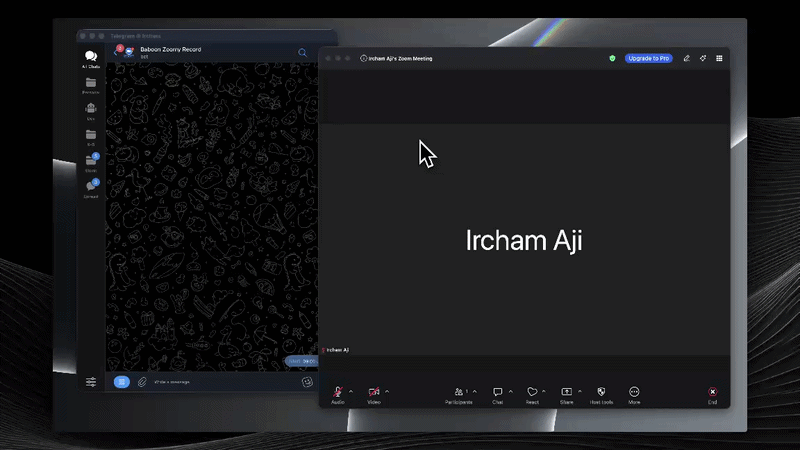
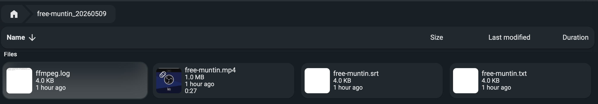

# Zoomy

A Telegram bot that records Zoom meetings by joining as a browser guest — no Zoom account or host access required.

## Demo

**Bot flow** (`/record` → schedule → join → stop)



**Recording output sample**



## How it works

Zoomy uses Playwright to join a Zoom web client session on a virtual display (Xvfb), then captures the screen and audio with FFmpeg.

```
/record <zoom_url|meeting_id>
  → URL validated + shortened URLs auto-resolved
  → Playwright joins zoom.us/wc/<id>/join on a dedicated Xvfb display
  → Bot waits for first audio on the virtual sink (parec RMS check)
  → FFmpeg x11grab + PulseAudio null sink → libx264 MP4
  → Bot watches DOM for meeting-end signal
  → On end/stop: saves MP4 to /recordings, notifies Telegram + screenshot
```

## Bot commands

### BotFather `/setcommands`

```
record - Start recording a Zoom meeting
stop - Stop the active recording
peek - Screenshot with duration, size, and URL
schedule - View, reschedule, or cancel scheduled recordings
status - Active count + total across all users
history - Browse recordings, transcribe, rename, or AI summary
```

### Command reference

| Command | Description |
|---------|-------------|
| `/record [url_or_id]` | Start recording a Zoom meeting |
| `/stop` | Stop the active recording |
| `/peek` | Screenshot of the active meeting with duration, size, and URL |
| `/schedule` | View, reschedule, or cancel scheduled recordings |
| `/status` | Your active count + total across all users |
| `/history` | Browse recordings; transcribe, rename, send transcript, or AI summary |

Any unknown command (including `/start`) returns the command list.

### `/record` flow

1. **URL or Meeting ID** — pass inline or send after the prompt (100s timeout → cancelled)
   - Full URL with password: `https://zoom.us/j/97856007427?pwd=xxx`
   - URL without password: `https://zoom.us/j/97856007427`
   - Meeting ID only: `97856007427` or `978 5600 7427`
   - Shortened URL: `bit.ly/meeting` — auto-resolved via HTTP redirect
2. **Password** — if URL/ID has no embedded password, bot asks for the plain passcode (Skip to proceed without)
3. **Bot name** — change the display name, or use the default (100s timeout → auto-selects default)
4. **Recording name** — type a label used as filename prefix, or skip (100s timeout → auto-name)
5. **Start now or schedule** — start immediately, or pick a future date/time in WIB (UTC+7)
6. Bot joins meeting muted + camera off
7. **Audio wait** — if `AUDIO_WAIT_TIMEOUT` is non-zero, FFmpeg is held until audio is detected on the virtual sink. If silence persists beyond 5 s, a "⏸ waiting…" notification fires; when audio is detected, a "▶️ started" notification follows. In an active meeting audio is usually detected immediately with no notification at all. Use `/stop` to abort while waiting.
8. Recording starts → initial screenshot sent

Multiple concurrent recordings are supported. Each session gets its own isolated display and audio sink. Per-user isolation: each authorized user manages only their own sessions.

## Stack

| Component | Role |
|-----------|------|
| Playwright (Chromium) | Joins Zoom web client, watches for meeting end |
| Xvfb (per session) | Virtual display — one per active recording |
| PulseAudio null sink (per session) | Virtual audio device for FFmpeg capture |
| FFmpeg x11grab + pulse | Screen + audio → MP4 (libx264, yuv420p, faststart) |
| python-telegram-bot v22 | Telegram bot interface |
| faster-whisper | Local speech-to-text transcription (CPU, int8) |
| ChatGPT Codex via CLIProxyAPI | AI meeting summary with optional ChatGPT web search |
| FileBrowser Quantum | Public share links for recordings (bypasses Telegram's 50MB upload cap) |

## Project structure

```
zoomy/
├── bot/
│   ├── bot.py            # Telegram bot, command handlers, session flow
│   ├── recorder.py       # ZoomRecorder + DisplayPool (Playwright + FFmpeg)
│   ├── transcriber.py    # faster-whisper wrapper (MP4 → .txt + .srt)
│   ├── summarizer.py     # ChatGPT Codex wrapper (transcript → AI summary)
│   ├── filebrowser.py    # FileBrowser Quantum API wrapper (public share links)
│   ├── store.py          # SessionStore — per-user in-memory state
│   ├── zoom_login.py     # One-off helper: save a signed-in Zoom session
│   ├── entrypoint.sh     # Container startup (PulseAudio + Xvfb base)
│   ├── Dockerfile
│   └── requirements.txt
├── cli-proxy/
│   ├── config.example.yaml # private CLIProxyAPI configuration template
│   └── auths/              # persisted ChatGPT OAuth tokens (gitignored)
├── recordings/           # MP4 output (bind-mounted into container)
├── secrets/              # zoom_state.json — saved Zoom login (gitignored)
├── docker-compose.yml
└── .env.example
```

## Setup

### 1. Clone and configure

```bash
git clone <repo>
cd zoomy
cp .env.example .env
# Edit .env with your values
```

### 2. Environment variables (`.env`)

```env
TELEGRAM_TOKEN=your_bot_token
AUTHORIZED_USER_IDS=111111111,222222222   # comma-separated Telegram user IDs; leave empty to allow all
OWNER_TELEGRAM_ID=466165038               # gets a one-time alert when an unauthorized user messages the bot
GUEST_NAME=zoomy.ircham.dev               # default bot display name in meetings
RECORDINGS_DIR=/recordings
ZOOM_STATE_PATH=/secrets/zoom_state.json  # saved Zoom login; see "Signed-in join". Missing file = anonymous guest join
DEBUG=false                               # set true to save debug screenshots

WHISPER_MODEL=medium                      # tiny | base | small | medium | large-v3
WHISPER_LANGUAGE=id                       # BCP-47 code, or leave empty for auto-detect
WHISPER_THREADS=                          # CPU threads (defaults to all cores)

CLIPROXY_BASE_URL=http://cli-proxy-api:8317/v1  # private CLIProxyAPI service URL
CLIPROXY_API_KEY=replace-with-random-secret      # matches cli-proxy/config.yaml api-keys entry
SUMMARY_MODEL=gpt-5.6-luna                       # default ChatGPT Codex model
SUMMARY_PREPROCESS_MODEL=gpt-5.6-luna            # identifies gaps before summarization
SUMMARY_WEB_SEARCH=true                          # enable the ChatGPT Codex web_search tool

AUDIO_WAIT_TIMEOUT=1     # non-zero = wait for audio before starting FFmpeg; 0 = start immediately
AUDIO_RMS_THRESHOLD=100  # RMS level (0–32767) that counts as "audio present"

WHISPER_INITIAL_PROMPT=  # domain context injected into Whisper's context window (leave empty for built-in default)
WHISPER_HOTWORDS=        # comma-separated words to boost during beam search (leave empty for built-in default)

FILEBROWSER_URL=                    # e.g. https://share.example.com; leave empty to disable the Share Link buttons
FILEBROWSER_API_TOKEN=              # long-lived API token created in FileBrowser Quantum's UI
FILEBROWSER_SOURCE_NAME=recordings  # source name as configured in FileBrowser Quantum's config.yaml
FILEBROWSER_SHARE_EXPIRY_DAYS=90    # share links auto-expire after this many days
```

Get your Telegram user ID from [@userinfobot](https://t.me/userinfobot).

### 3. Connect ChatGPT through CLIProxyAPI

Zoomy uses a private [CLIProxyAPI](https://github.com/router-for-me/CLIProxyAPI) sidecar and one ChatGPT Codex OAuth connection. The ChatGPT token stays in `cli-proxy/auths/`; Zoomy only receives the internal proxy API key.

```bash
cp cli-proxy/config.example.yaml cli-proxy/config.yaml
# Generate a secret, then set the same value in config.yaml and .env.
openssl rand -hex 32
docker compose up -d cli-proxy-api
docker compose exec cli-proxy-api ./CLIProxyAPI -codex-device-login
```

Open the URL and enter the device code printed by the final command. This may require enabling **Device code authorization for Codex** in ChatGPT's **Settings → Security and login** first. The OAuth token is refreshed in the proxy volume automatically. Keep `cli-proxy/config.yaml` and `cli-proxy/auths/` private and never commit them.

### 4. Run

```bash
docker compose up -d --build
```

### 5. Access recordings

Recordings are available via the `recordings/` bind mount, through FileBrowser Quantum at port `7011` (browse everything, admin login required), or as an individual **Share Link** sent by the bot (public, no login, no folder browsing — see below).

## Signed-in join

By default the bot joins anonymously, as a guest. A host can require every participant to be signed in with a Zoom account, and that guest join is then refused:

> Host requires participants to be signed in with a Zoom account — the bot joined as a guest and was refused.

Two ways past it.

### Option A — give the bot its own Zoom account (works unattended, every meeting)

Sign in once by hand, save the session, mount it. The recorder loads it into every browser session it opens.

```bash
pip install playwright && playwright install chromium   # on your laptop, once
python3 bot/zoom_login.py
```

A browser window opens on `zoom.us/signin`. Log in as the account the bot should use, finish any 2FA, then press Enter in the terminal. The script verifies the session is real and writes `secrets/zoom_state.json`.

Copy that file to the server's `secrets/` directory and rebuild:

```bash
scp secrets/zoom_state.json ircham@baboon:~/docker/zoomy/secrets/ && ssh ircham@baboon 'cd ~/docker/zoomy && docker compose up -d --build'
```

The login is manual on purpose — Zoom answers scripted credential entry with 2FA prompts, device-verification mail and CAPTCHAs, and this way the password never goes into `.env`.

Notes:

- **`secrets/zoom_state.json` is a live login.** It is gitignored, written `0600`, and mounted read-only. Anyone holding it is signed in as that account.
- **Sessions expire** after a few weeks. When they do, the bot reports *"Zoom rejected the bot's saved sign-in — the session has almost certainly expired"* — re-run `zoom_login.py` and redeploy.
- **The display name comes from the Zoom account**, not `GUEST_NAME`, whenever Zoom hides the name field for signed-in users. Set the account's profile name to whatever you want shown in meetings.
- **Domain-restricted meetings still refuse it.** Hosts can demand sign-in *with a specific domain* (`@company.com`); a personal account doesn't qualify. The wall text is identical, so a persistent failure with a valid session means you're facing this variant — use Option B, or an account inside that domain.

### Option B — ask the host for an authentication-exception link

The host adds the bot under **Meeting settings → Authentication exception** (name + email); Zoom issues a unique join link carrying a `tk=` token that bypasses the requirement. Paste that whole link into `/record` — no bot-side setup at all.

Pass the link **verbatim**: the `tk` token is what does the work.

## `/history` actions

After selecting a recording from the `/history` listing:

| State | Available actions |
|---|---|
| No transcript | 🎙 Transcribe (Medium / Large) · 📤 Share Link · ✏️ Rename |
| Transcript exists | 📄 Send Subs · 🔄 Re-Subs · 🤖 AI Summary · 📤 Share Link · ✏️ Rename |
| Transcript + Summary | 📄 Send Subs · 🔄 Re-Subs · 📋 Send Summary · 💬 Ask AI · 📤 Share Link · ✏️ Rename |

📤 Share Link only appears when `FILEBROWSER_URL` + `FILEBROWSER_API_TOKEN` are set.

**Re-Subs** opens a second choice for the Whisper `Medium` or `Large` model before creating the replacement transcript and subtitle files.

**Rename** renames the folder and all files inside that share the same stem prefix.

## AI Summary

Zoomy generates structured meeting summaries through ChatGPT Codex, via the private CLIProxyAPI service.

**Flow:**
1. Click **🤖 AI Summary** from `/history`, or from the button after transcription. Once a summary exists, use **💬 Ask AI** to reopen its conversation or **📋 Send Summary** to send it without opening a conversation.
2. Bot uses the SRT as the source of truth, merging nearby cues into readable timestamped blocks such as `[00:12:42 - 00:18:05]`
3. For long meetings, bot summarizes bounded chronological sections first, then uses those section summaries to produce the final summary
4. Bot pre-processes the transcript with `SUMMARY_PREPROCESS_MODEL` to identify missing context or ambiguous references
5. If gaps found, bot shows clarification questions — answer or press **Skip**
6. Bot shows live status: `🔍 Mencari informasi di web…` / `✍️ Membuat ringkasan…`
7. Summary streams live to Telegram and is cached to `.summary.txt`
8. Bot enters a correction conversation for that user and recording; reply with changes or questions, or send `/exit` to end it. It ends automatically after five minutes without a user response.
9. Every AI response includes a quoted `/exit` reminder; a revised full summary replaces `.summary.txt`
10. The transcript remains available from `/history`; it is not offered again while the correction conversation is active

**Summary structure:**
```
💭 [one-sentence context understanding]

**Tentang Rapat** · **Pembahasan** · **Keputusan** · **Tindak Lanjut**
```

**Web search:** when `SUMMARY_WEB_SEARCH=true`, the initial summary declares the Codex-native `web_search` tool. CLIProxyAPI forwards it to the linked ChatGPT account. Follow-up correction turns rely on the transcript evidence and summary already available, avoiding an unnecessary external search delay. Disable it when summaries must rely only on the transcript.

**Timestamped context:** `.srt` remains the canonical AI source because it carries timing. Zoomy removes SRT numbering and merges nearby cues into approximately three-minute blocks. The `.txt` transcript remains available for search and is used only as a fallback when no SRT exists. Long-meeting section summaries are saved internally as `.summary-timeline.txt`; a new transcription clears that file. Follow-up chat sends the current summary, this chronological outline when available, and only timestamped source blocks relevant to the user's question. Questions such as `apa yang dibahas pada menit 30?` select the surrounding timeline blocks directly.

**Built-in glossary:** BSSN, BSrE, Komdigi, Kominfo, PDP, KSS, D32, TTE, SPBE, Pemdi/Pemdigi, PSrE, NSPK, RKA

**Reasoning:** summaries request low reasoning effort to keep `gpt-5.6-luna` responsive and preserve ChatGPT subscription quota.

## Share Link

Recordings routinely exceed Telegram's 50MB bot-upload limit, so instead of sending the file directly, Zoomy generates a public share link via [FileBrowser Quantum](https://filebrowserquantum.com/).

**Flow:**
1. Offered automatically as a **🔗 Copy Share Link** button on the "Recording saved" message, or on-demand via **📤 Share Link** from `/history`
2. Bot creates a hash-based public share (`{FILEBROWSER_URL}/public/share/{hash}`) scoped to that single file — no folder browsing, no login required to view or download
3. Tapping the button copies the link straight to your clipboard (Telegram's native copy-to-clipboard button) rather than opening a page
4. Message shows the exact expiry date/time (WIB); link stops working then — the share row stays visible in FileBrowser's admin panel afterward so it can still be edited/extended, but public access is cut off exactly at expiry regardless

Requires `FILEBROWSER_URL` + `FILEBROWSER_API_TOKEN`; both buttons are hidden entirely if unset.

## Transcription

Zoomy uses **faster-whisper** for local, CPU-only transcription (no cloud API needed).

| Setting | Default | Notes |
|---|---|---|
| `WHISPER_MODEL` | `medium` | `tiny` / `base` / `small` / `medium` / `large-v3` |
| `WHISPER_LANGUAGE` | `id` | BCP-47 code; leave empty for auto-detect |
| `WHISPER_THREADS` | all cores | CPU thread count |

**VAD filter** — silent segments (waiting room, pauses) are skipped before inference, keeping transcription fast.

**Domain vocabulary** is injected in two ways:

- `WHISPER_INITIAL_PROMPT` — primes Whisper's context window with a meeting description, teaching spelling and style of domain terms (BSSN, BSrE, TTE, SPBE, Pemdigi, etc.)
- `WHISPER_HOTWORDS` — boosts token probability during beam search for a comma-separated list of terms

Both have sensible defaults covering Indonesian government / cybersecurity vocabulary (BSSN, Komdigi, IKASANDI, IKAMI, PDP, KSS, D32, BSrE, PSrE, NSPK, RKA, SPBE, TTE, Pemdigi, Pemdi, IPPD, LPPD, TTIS, CSIRT, Sanapati, Forkomsanda, Manrisk, PTKKSS, and more). Override via env vars.

## Scheduling

`/schedule` lists all pending recordings. Each entry has **[🔄 Reschedule]** and **[❌ Cancel]** buttons.

Reschedule flow: enter new date/time in natural language (WIB, UTC+7) → confirm → updated. 100s timeout per input step.

Schedules persist across bot restarts via `recordings/schedules.json`. On startup, missed schedules trigger a user notification; future schedules are re-queued with the remaining delay.

## Recording filename format

```
{name}_{YYYYMMDD}/          # named session   → folder + MP4 inside
{randomname}_{YYYYMMDD}/    # auto-named session
```

## Planned features

### Scheduling
- **Recurring schedule** — record the same meeting every day/week at the same time; ideal for standups
- **Pre-recording reminder** — send a Telegram message X minutes before a scheduled recording fires
- **Clone schedule** — duplicate a pending schedule to a new time without re-entering all details

### History & file management
- **Delete from `/history`** — delete a recording folder directly from the bot with a confirm step
- **Search in `/history`** — filter the listing by keyword instead of paginating through everything
- **Auto-cleanup** — automatically delete recordings older than a configurable number of days
- ~~**`/download`**~~ ✅ — superseded by **Share Link**: generates a public FileBrowser Quantum link instead of hitting Telegram's 50MB upload cap

### Recording control
- ~~**Pause/resume**~~ ✅ — from the silence warning, **⏸ Pause recording** stops the encoder and skips the silent gap entirely (recording is captured as segments and concatenated on stop), then auto-resumes when audio returns. Not a frozen frame — the paused period is absent from the final video, and duration/size exclude it.
- **Audio-only mode** — record audio track only; much smaller files and faster transcription
- **Recording markers** — send `/mark <label>` during an active recording to drop a named timestamp
- **Trim on stop** — optionally cut the first/last N seconds off the saved MP4
- **Clip extraction** — extract a time range from a recording as a shorter clip via FFmpeg

### Recording reliability
- **Rejoin on kick** — if Zoom removes the bot (waiting room, meeting lock), auto-rejoin once and notify
- ~~**Silent audio warning**~~ ✅ — detect continuous silence mid-recording; Telegram warning (with live screenshot) after `SILENT_WARN_SECS` with three actions: **🔔 Keep recording · alert when audio returns** (keeps recording, pings when audio returns, and reminds every `SILENT_SNOOZE_SECS` while still silent), **⏸ Pause recording · resume when audio returns** (stops the encoder, skips the silent gap, auto-resumes on audio), **⏹ Stop recording**
- **Disk space alert** — notify when free space on `/recordings` drops below a configurable threshold
- ~~**Audio-wait on join**~~ ✅ — hold FFmpeg until first audio is detected on the virtual sink after joining; Telegram notified on wait start ("⏸") and on audio detection ("▶️"); `/stop` works while waiting; configurable via `AUDIO_WAIT_TIMEOUT` / `AUDIO_RMS_THRESHOLD`

### During the meeting
- ~~**Breakout room invite**~~ ✅ — when the host invites the bot to a breakout room, a Telegram prompt (with live screenshot) offers **✅ Join** / **✋ Not Now**. If nobody answers within `BREAKOUT_AUTOJOIN_SECS` (default 100s) the bot auto-joins; the chosen button is then clicked on the virtual screen. Only host-initiated invites are acted on. Set `BREAKOUT_AUTOJOIN_SECS=0` to join immediately, or a negative value to ignore invites.

  Because hosts routinely set breakout rooms up in a *silent* meeting, the invite gets priority over the audio-silence machinery in two ways:
  - **Detected before recording starts** — invites are polled during the audio wait too, not just in the main watch loop. Otherwise a bot parked in "waiting for audio" (an unbounded wait) would never see the invite until the meeting made a sound.
  - **Outranks silence handling** — if an invite appears while a silence warning/pause is active, the silence treatment is cancelled (the encoder resumes if it was paused) and the silence Telegram message + screenshot are deleted, keeping the user focused on the invite.

  Zoom stacks the invite on top of other modals (e.g. "This meeting is recorded"), so the invite dialog is located by anchoring on its **Not Now** button and walking up to the smallest ancestor holding both the **Join** button and the invite text — matching an outer container would mix both dialogs' text and buttons together. The notice underneath is dismissed normally, with the invite's own buttons protected.
- **Zoom chat capture** — scrape the in-meeting chat from the browser DOM and save alongside the recording
- **Attendance log** — periodically scrape the participant list from the DOM and save to `.metadata.json`
- **Waiting room notification** ⭐ — detect when the bot is stuck in a waiting room and notify the user

### Transcription & analysis
- **Multilingual / bilingual transcription** — auto-detect language via `language=None` in Whisper; useful for meetings that mix Indonesian and English
- **Speaker diarization** — label transcript segments with who spoke using `pyannote.audio`
- **Action item extraction** — scan transcript for "saya akan…", "kita perlu…", etc.
- **Subtitle burn-in** — embed the SRT file directly into the MP4 with FFmpeg
- ~~**Transcript summary**~~ ✅ — AI summary via ChatGPT Codex and CLIProxyAPI; optional web search; pre-processor detects context gaps; cached to `.summary.txt`
- **Transcript translation** — translate the transcript to another language after transcription

### Search & discovery
- **`/search <keyword>`** — search across all transcript `.txt` files and return matching recordings
- **Talk time per speaker** — if diarized, show percentage of time each speaker talked

### Bot UX
- **Webhook on stop** — POST recording metadata to a configurable URL when a recording finishes
- **Telegram channel push** — optionally forward the stop summary to a group or channel
- **Pin active recording message** — pin the "recording started" message in chat

### Multi-user & admin
- **User management from bot** — `/admin adduser <id>` and `/admin removeuser <id>`
- **Per-user storage quota** — limit disk space per authorized user
- **`/stats`** — total recordings, total hours, total disk used

### Integrations
- **Google Calendar** — poll a calendar and auto-schedule when a Zoom link is detected in an event
- **Auto-export transcript** — after transcription, write `.txt` to a mounted Obsidian vault or shared folder

## Recording crop

Each session runs on a **1920×1200 virtual display** (Xvfb). The extra 120px gives the browser chrome room to exist without eating into meeting content.

After joining, the bot measures browser chrome height once via JavaScript:

```js
window.outerHeight - window.innerHeight  // e.g. 90px
```

FFmpeg starts with a `-vf crop=1920:{h}:0:{chrome_height}` filter baked in — applied live from the first frame. The saved MP4 has chrome stripped; no post-processing needed.

Example: chrome = 90px → `crop=1920:1110:0:90` → output is 1920×1110  
Example: chrome = 120px → `crop=1920:1080:0:120` → output is 1920×1080

## Notes

- Requires Docker with `shm_size: 2gb` (set in `docker-compose.yml`) for Chromium stability
- Bot joins meetings muted with camera off
- Meeting-end detection polls `document.body.innerText` every 3s — stops automatically when the host ends the meeting
- Stop notification includes duration, file size, and stop reason (host ended vs manually stopped)
- Displayed duration is measured from the moment FFmpeg starts (not browser join) and excludes paused time, so it stays consistent with the file size across `/peek` and the hourly notice
- The hourly "still running" notice and the silence warning both include a live screenshot, like `/peek`
- FFmpeg encodes at CRF 26, `veryfast` preset, 24fps — balanced quality/size for meeting content
- Invalid meeting links (error 3001, expired, etc.) are detected on join and reported immediately
- Meetings that require a signed-in Zoom account (guest join rejected → "Sign in to join this meeting") are detected on join; the recording is aborted with a notification instead of hanging
- AI Summary calls retry automatically (exponential backoff, up to 3 attempts) on transient CLIProxyAPI 408/429/5xx errors before surfacing a failure to the user
- If `AUTHORIZED_USER_IDS` is set, any message from an unlisted user gets a one-time rejection reply and `OWNER_TELEGRAM_ID` gets a heads-up with the sender's username/ID
